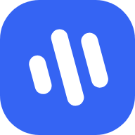
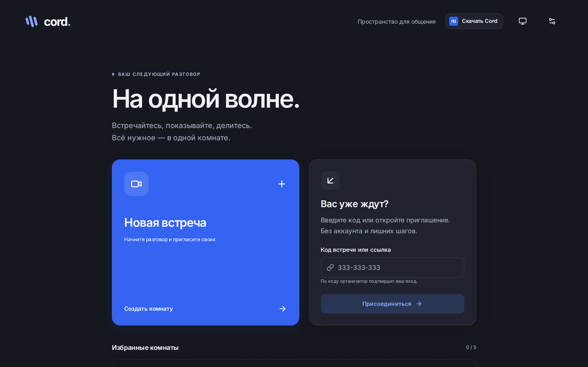
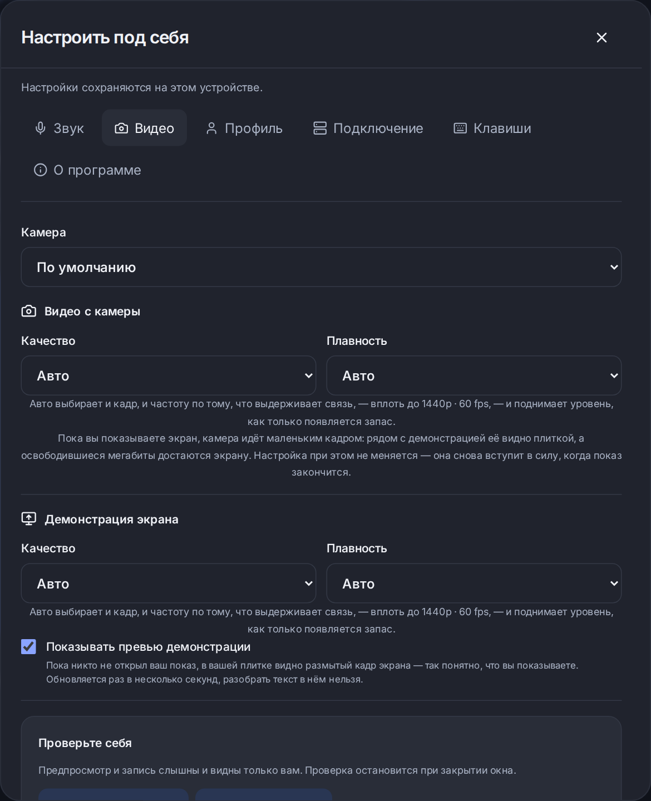

<div align="center">



# Cord для Windows

**Видеовстречи, которые можно поставить себе.**
Разговор, две демонстрации экрана до 1440p·60, чат, файлы и музыка — в приложении, которое
подключается к вашему собственному серверу.

[](https://cord.nikg.tech/download)

[](https://github.com/MikkiMays/ModernStreamingSystem.Windows/releases/latest)
[](https://github.com/MikkiMays/ModernStreamingSystem.Windows/actions/workflows/desktop.yml)
[](https://github.com/MikkiMays/ModernStreamingSystem)



</div>

---

## Что это

Cord — приложение для встреч, которое не принадлежит ничьему облаку. Сервер поднимается одной
командой на любой машине с публичным адресом, и дальше он ваш: комнаты, файлы, записи в базе,
сроки хранения. Клиент для Windows — приложение на Electron со своим Chromium (как Discord), Mica и
системной темой; сам разговор идёт через тот же React-клиент, что и в браузере, — он приходит с
сервера. Поэтому телефон, браузер и Windows входят в одни комнаты, с одними правами и одним
чатом, а исправления интерфейса приезжают с сервера, без переустановки.

|                           |                                                                                                                             |
| ------------------------- | --------------------------------------------------------------------------------------------------------------------------- |
| **Разговор**              | до 10 участников, камера и микрофон выключены, пока их не включат; видно, кто говорит                                        |
| **Экран**                 | две демонстрации одновременно, до **1440p · 60 fps**, звук экрана стерео, закрепление и зум                                  |
| **Качество**              | «Авто» само поднимается до 1440p·60, когда канал и процессор позволяют; выбранный вручную уровень не понижается сам и действует на приём тоже |
| **Чат и файлы**           | одна лента, перетаскивание, докачка через tus, сроки хранения                                                                |
| **Музыка**                | общая очередь в комнате, стерео, Яндекс Музыка и Telegram-бот                                                                |
| **Телефон**               | тот же адрес открывается в браузере и выносится на экран «Домой» как приложение                                              |
| **Восстановление**        | обрыв сети и переключение VPN переживаются без выхода из комнаты: 20 секунд на возврат                                        |
| **Обновления**            | при запуске заставка проверяет и ставит новую версию, без прав администратора; дельтами                                      |

<div align="center">

<br />
<sub>Кадр и частота выбираются отдельно для камеры и для экрана. Заявленное сверяется с фактическим прямо во встрече.</sub>
</div>

## Скачать

Установщик берётся со страницы **`/download` того сервера Cord, которым вы пользуетесь** — например,
[cord.nikg.tech/download](https://cord.nikg.tech/download). Один файл `Cord-Setup-<версия>.exe`
(NSIS, ~110 МБ): установка для текущего пользователя, без прав администратора; Chromium и нативный
модуль `cord-native` уже внутри, ни WebView2, ни .NET не нужны. Windows 10 x64 и новее.

> [!NOTE]
> Windows скажет «Система Windows защитила ваш компьютер» и назовёт издателя неизвестным:
> установщик не подписан сертификатом издателя. Нажмите **Подробнее** → **Выполнить в любом
> случае**. Это один раз, при установке. Почему так и что его убирает — в
> [installer.md](docs/installer.md#предупреждение-smartscreen-и-подпись).

## Свой сервер за одну команду

Нужна машина с публичным адресом и Docker. Имя домена желательно, но не обязательно — есть
режим с самоподписанным сертификатом прямо на IP.

```bash
git clone https://github.com/MikkiMays/ModernStreamingSystem.git
cd ModernStreamingSystem
sudo ./setup.sh --domain meet.example.com    # или: sudo ./setup.sh --ip-only
```

Скрипт спросит остальное сам, соберёт образы и поднимет ядро, SFU, TURN, базу и веб. Обновляется
сервер такой же одной командой — `./update.sh` из того же каталога. Подробный разбор с
картинками, режимами установки и проверками — в
**[docs/INSTALL.md](https://github.com/MikkiMays/ModernStreamingSystem/blob/main/docs/INSTALL.md)**.

<details>
<summary><b>Готовое задание для ИИ-ассистента</b> — если не хочется разбираться самому</summary>

Откройте на своём сервере Claude Code, Codex или любого другого агента с доступом к терминалу
и дайте ему это целиком:

```text
Подними мне видеосервер Cord на этой машине.

1. Клонируй https://github.com/MikkiMays/ModernStreamingSystem и прочитай docs/INSTALL.md
   целиком, прежде чем что-либо запускать.
2. Выясни, есть ли у машины публичный IP и домен, который на неё указывает. Если домена нет —
   ставь в режиме --ip-only, он работает с самоподписанным сертификатом.
3. Проверь, что порты 80, 443, 3478/udp, 5349, 7881 и 7882/udp снаружи доступны, и открой их
   в файрволе, если нет. Без UDP видео пойдёт через TURN и будет хуже.
4. Запусти setup.sh с нужным режимом. Дождись, пока все контейнеры станут healthy.
5. Проверь результат: открой адрес сервера, создай встречу, убедись, что страница отдаётся по
   HTTPS и что /download открывается.
6. Скажи мне адрес сервера и что именно ты проверил. Если что-то не сошлось — скажи что
   именно, не выдавай непроверенное за работающее.

Не выполняй docker compose down -v: это удаляет тома с базой и файлами.
```

Дальше впишите адрес сервера в Cord при первом запуске — и всё. Обновлять сервер потом —
`./update.sh` из того же каталога; он сам разберётся, что пересобирать, и откатится, если
новая сборка не поднимется.

</details>

## Серверы и настройки

Список серверов — **подписанный каталог Cord** (`GET /api/v1/catalog`, JWS Ed25519; ключи проверки
вшиты в клиент): страна, флаг, пинг и загрузка сервера четырьмя палочками (R143). Чужой адрес в
каталог не попадёт даже со взломанного сервера — закрытого ключа на серверах нет. Сервер меняется
обычной навигацией, после подтверждения выхода из встречи.

**Настройки — одни на всё приложение и на все серверы** (с 1.1.0): устройства, обработка звука,
качество, горячие клавиши, оформление, токен Яндекс Музыки. У сервера своё только то, что ему и
принадлежит, — комнаты и избранное. Секреты (пароль сервера, токен) шифруются `safeStorage`
(DPAPI текущего пользователя).

**Обновления приходят с одного фиксированного адреса и не следуют за выбранным сервером:**
вход в чужую комнату не должен решать, какой исполняемый файл поставится на эту машину.
При запуске, как в Discord, сначала появляется маленькая заставка: она проверяет, нет ли новее,
скачивает и ставит обновление — и только потом открывает Cord. Во время встречи обновление ждёт
её конца. Сервер обновлений недоступен — Cord открывается как обычно. Номер версии виден только
в «О программе». Подробности — в [updating.md](docs/updating.md).

## Из чего собрано

**Клиент:** Electron, TypeScript (main, preload, страницы `cord-app://`), нативный модуль
`cord-native` на Rust + napi-rs (Raw Input для push-to-talk, звук приложения через WASAPI process
loopback, переднее окно для оверлея), electron-updater с подписью Ed25519, установщик NSIS.
**Ядро:** Java 25 / Spring Boot 4, PostgreSQL 18, Redis 8, Flyway, tusd.
**Медиа:** LiveKit SFU, WebRTC, кодеки AV1/VP9/H.264 по видеокарте и сети, собственный TURN.
**Веб:** React 19 с React Compiler, TypeScript, Vite 8, Base UI, LiveKit Client SDK.
**Инфраструктура:** Docker Compose, Caddy.

## Собрать из исходников

Нужны Node.js 24 и, для `cord-native`, Rust (версия закреплена в `desktop/native/rust-toolchain.toml`).
Сборка установщика и e2e — только на Windows; модульные тесты идут где угодно.

```bash
cd desktop
npm ci
npm run typecheck && npm test   # типы и модульные тесты (vitest)
npm run build:native            # cord-native (Windows)
npm run start                   # собрать и запустить
npm run dist                    # установщик NSIS в dist/
npm run test:e2e                # Playwright _electron против сервера (Windows)
```

Выпуск — пуш в `main` с новой версией в `desktop/package.json`: CI `desktop.yml` собирает, проверяет
установщик на windows-2022 и публикует релиз `desktop-vX.Y.Z`; на зеркало сервера его кладёт
`backlog/bin/publish-windows.sh --desktop X.Y.Z` из репозитория ядра. Пошагово — инструкция выпуска
ядра: [`docs/RELEASE.md`](https://github.com/MikkiMays/ModernStreamingSystem/blob/main/docs/RELEASE.md).

## Структура

| Каталог                        | Ответственность                                                                          |
| ------------------------------ | ---------------------------------------------------------------------------------------- |
| `desktop/src/main`             | Окна, мост `window.cordDesktop`, обновление, каталог, трей, оверлей, мини-окно, захват    |
| `desktop/src/preload`          | Узкие API для страницы сервера и для локальных страниц                                    |
| `desktop/src/shell`            | `cord-app://`: заставка обновления, загрузка, офлайн, серверы, оверлей, мини-окно звонка  |
| `desktop/native`               | `cord-native` (Rust): клавиши, звук приложения, окна                                     |
| `desktop/build`                | Установщик NSIS, иконки, ключи проверки обновлений и каталога                            |
| `desktop/test`                 | vitest (модули) и Playwright `_electron` (смоук, оверлей, мини-окно)                      |
| `.github/workflows/desktop.yml`| Сборка, тесты, проверка установщика и выпуск релиза                                      |
| `docs/releases`                | Заметки о выпусках (`desktop-X.Y.Z.md`; `0.x.md` — прежний клиент WinUI, удалён 01.11.2026) |

## Что проверено, а что нет

CI на каждый пуш в `desktop/`: типы, модульные тесты, тесты `cord-native`, смоук Playwright
`_electron` (оверлей над игрой, мини-окно звонка, нативный модуль в utility-процессе) и проверка
собранного установщика (тихая установка, ярлыки, удаление, обновление поверх прошлого выпуска).
Общие сценарии встреч проверяются браузерным набором ядра с настоящим SFU.

Ещё требуют живого железа: аппаратный AV1 на конкретных видеокартах, разные DPI при звонке,
игры с античитом под оверлеем. Подпись издателя (Authenticode) не сделана — нужен сертификат.

## Дальше

[Архитектура клиента](docs/architecture.md) ·
[ADR 0001 — почему Electron и как устроен](docs/adr/0001-electron-shell.md) ·
[Установщик и подпись](docs/installer.md) ·
[Как работают обновления](docs/updating.md) ·
[Заметки о выпусках](docs/releases) ·
[Ядро, веб и инфраструктура](https://github.com/MikkiMays/ModernStreamingSystem)

## Автор

Cord создаёт и развивает **[@nikgers](https://t.me/nikgers)** — пишите в Telegram по вопросам,
предложениям и сотрудничеству.
